<!-- Crypto Intelligence AI user manual v3 (21 Nov 2026). Built by scripts/build_manual.py into frontend/public/manual.pdf.
Blocks: 
, 
, <ol class="steps">, 
, 
, 
,

 (desktop + phone screenshots). Every "## " heading starts a section; its {#id} feeds the contents. -->

## Welcome {#welcome data-kicker="01" data-line="What the app is, in one minute"}

Crypto Intelligence AI is your companion for crypto market insights, trading signals and smarter practice.

It watches the market around the clock. When it finds a setup worth considering, it shows you a **signal**: which coin, which direction, where to enter, where to stop a loss and where to take profit. You can test every idea with **virtual money** before you ever risk your own.

### Find setups
The AI scans many coins on six timeframes and tells you when something is worth a look, and when it is better to wait.

### Understand the market
A daily briefing, a market mood, news and the economic calendar explain what is moving prices.

### Practise safely
A practice account with virtual USDT lets you try every signal, by hand or automatically, with no real money.

**Good to know.** The app is for analysis and practice. It never places real orders on an exchange. Signals are not guaranteed to win, and past results do not guarantee future results. Always decide for yourself.

## What you get {#what-you-get data-kicker="02" data-line="Every feature, and why it matters to you"}

Each card answers two questions: **what does it do**, and **how does it help you**.

### AI trading signals
**What:** a clear plan for a trade: direction, entry, stop-loss and up to three take-profit targets.
**Helps you:** you get a ready-made plan instead of guessing where to get in and out.

### Market analysis
**What:** the AI's view of each coin: trend, direction, support and resistance, and a short report.
**Helps you:** you understand *why* a coin looks strong or weak before you act.

### Long and short ideas
**What:** signals for rising markets (long) and falling markets (short).
**Helps you:** you have ideas in both directions, not only when prices go up.

### Spot and futures
**What:** buy-only ideas for spot, and long or short ideas with a suggested leverage for futures.
**Helps you:** you see ideas for the way you prefer to trade.

### Six timeframes
**What:** 15 minutes, 1 hour, 4 hours, 12 hours, 1 day and 3 days.
**Helps you:** short ideas if you watch the market often, longer ones if you check in once a day.

### Radar and Money flow
**What:** coins that are moving or getting busy, and where large buyers and sellers are active.
**Helps you:** you find coins worth watching without scanning charts yourself.

### Alerts and notifications
**What:** messages on your phone when a signal appears, a target is reached or a price is touched.
**Helps you:** you don't have to watch the screen all day.

### Practice trading
**What:** spot and futures trading with virtual USDT, on live prices.
**Helps you:** you learn and test without risking real money.

### Auto-trade (practice only)
**What:** the app places its signals in your practice account for you.
**Helps you:** you see how the signals would work for you, even while the app is closed.

### Results you can check
**What:** every published signal, wins and losses, after fees, plus demo bots that follow them.
**Helps you:** you judge the app by its real record, not by promises.

### Backtest and Replay
**What:** test a simple strategy on past prices, or replay what the AI said at an earlier moment.
**Helps you:** you see how ideas would have behaved before you trust them.

### News, calendar and Community
**What:** crypto headlines, the US economic calendar, and a place to talk with other members.
**Helps you:** you know about market-moving events and can learn from others.

## Getting started {#getting-started data-kicker="03" data-line="From first visit to your first signal in five minutes"}

<ol class="steps" markdown>
<li markdown>**Open the app.** Go to **cryptointelai.com** on your phone or computer.</li>
<li markdown>**Create your account.** Press **Continue with Google**, or **Sign up with email**. With email, choose a password of at least 8 characters, then open the confirmation email and tap its link.</li>
<li markdown>**Choose a membership.** Pick a plan, pay as shown in the app, and upload your payment screenshot. The app opens as soon as your payment is approved.</li>
<li markdown>**Install it on your phone.** Android: **Settings → Install the app → Download the Android app (APK)** (needs Google Chrome). iPhone: open the site in **Safari → Share → Add to Home Screen**.</li>
<li markdown>**Turn on notifications.** **Settings → Notifications → Turn on notifications**, then **Send a test notification**.</li>
<li markdown>**Pick your view.** **Beginner** shows the essentials; **Pro** shows every number. Switch at the top of the screen, in **More** on phones, or in **Settings → View mode**.</li>
</ol>

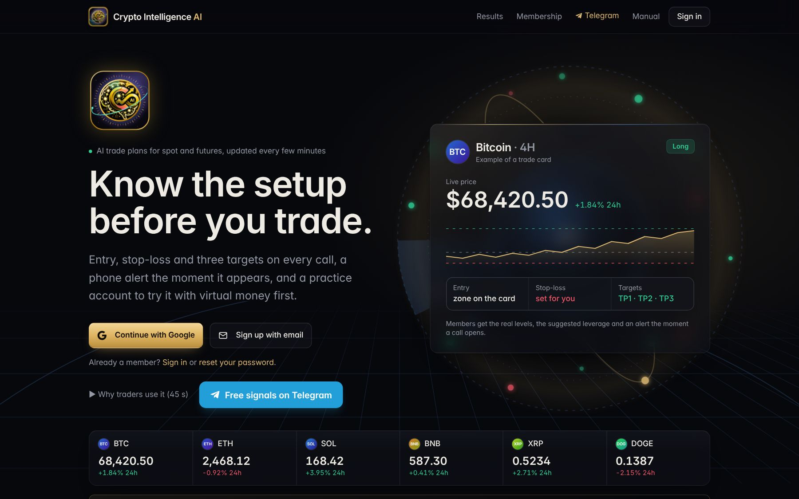

**Plans and prices.** Current membership plans, prices and payment options are always shown on **cryptointelai.com** and in the app under **Settings → Membership**.

## Your dashboard {#dashboard data-kicker="04" data-line="The home screen: the market at a glance"}

Home is where you start each visit. From top to bottom:

### Market mood and briefing
A one-line summary of the market (for example "leaning bullish") and a short AI briefing.
**Why it matters:** you know the general direction before looking at single coins.

### Bitcoin and the market
BTC price and change, total market size, Bitcoin's volatility and the Fear & Greed reading.
**Why it matters:** most coins follow Bitcoin, so its mood sets the tone.

### Live signals
The open signals with their progress from stop to targets, and an opportunity board.
**Why it matters:** you see at once which ideas are running well and which need care.

### Activity and performance
What happened recently, and how the published signals have done so far.
**Why it matters:** a quick, honest check of how the app is doing.

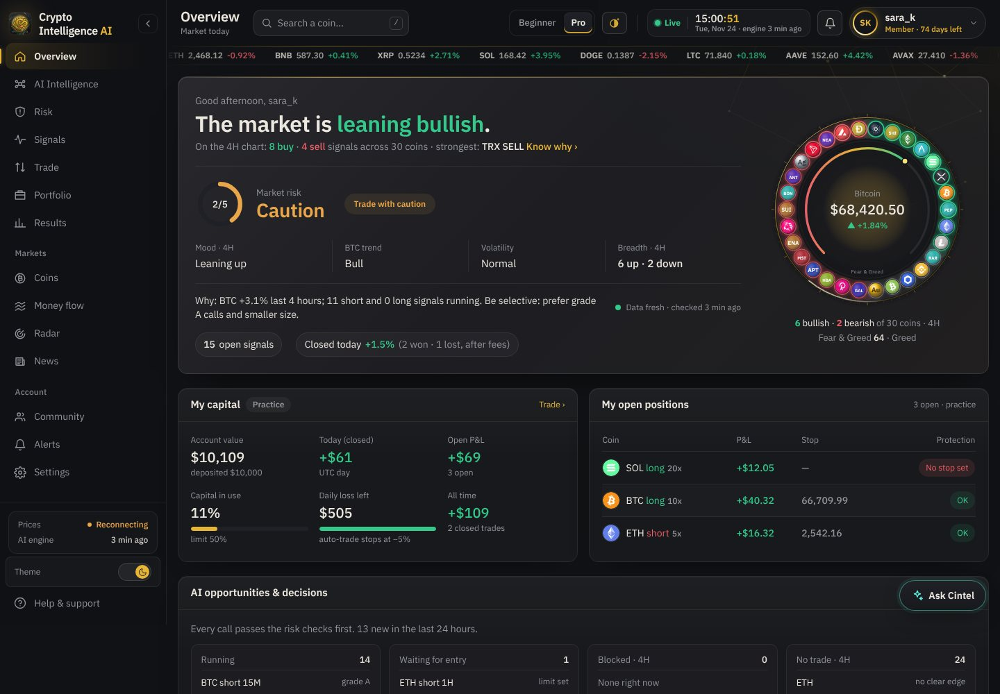
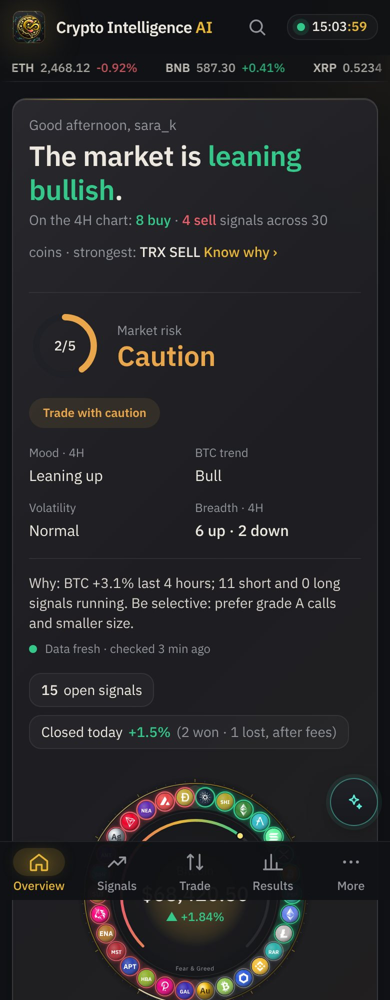

**Want to know more? Pro users.** **Command Centre** (menu: Markets) shows the whole watchlist as a galaxy, an opportunity radar for all timeframes and a deep scan of any coin. **Money flow** shows large buyers and sellers, forced closes, order-book walls and funding.

## Understanding AI signals {#signals data-kicker="05" data-line="How to read a signal card, step by step"}

A **signal** is a trade idea with a full plan. It never tells you that a trade will win; it shows a setup the AI considers worth your attention, with clear levels so you know your risk before you start.

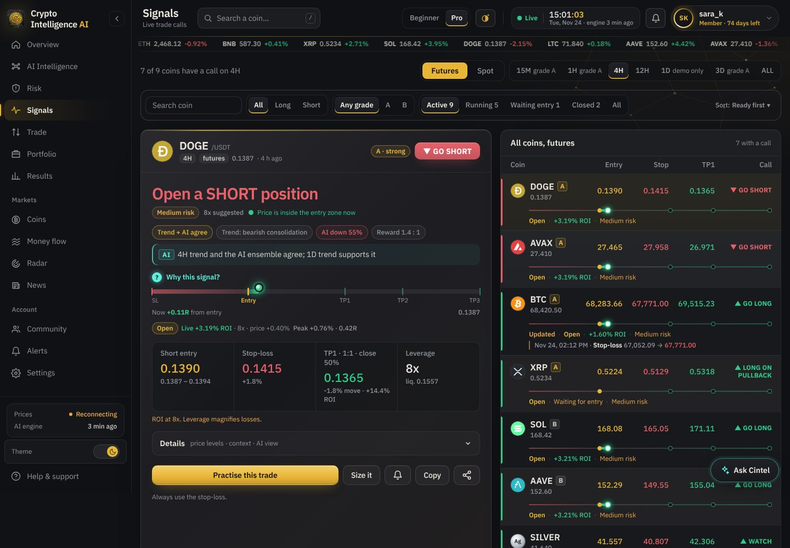

### The words on a signal card

- **Long / Buy:** the AI expects the price to **rise**.
- **Short / Sell:** the AI expects the price to **fall** (futures only).
- **WAIT or NO TRADE:** no good setup right now. The card says why. Waiting is a valid decision.
- **Grade A:** strong. The trend, the AI models and their past record agree.
- **Grade B:** moderate. The AI sees an edge, but not everything agrees.
- **Entry:** the price to open the trade at. **Entry zone:** a small range where entering is still fine.
- **Stop-loss (SL):** the price where the trade is closed to limit the loss.
- **Take-profit 1, 2, 3 (TP1–TP3):** targets. Half closes at TP1, a quarter at TP2, the rest at TP3. After TP1 the stop moves to the entry, so the rest can no longer lose.
- **Timeframe:** the candle size the idea is based on. Shorter means faster trades.
- **Status:** Waiting for entry, Running, or Closed (with the result).
- **Why:** the short reason under the card, for example "trend and AI agree".

### How to use signals

<ol class="steps" markdown>
<li markdown>Open **Signals**.</li>
<li markdown>Choose **Futures** (long and short) or **Spot** (buy only).</li>
<li markdown>Pick a **timeframe**, or **All** to see every open idea in one list.</li>
<li markdown>Choose a **coin** from the list.</li>
<li markdown>Read the signal: direction, grade and the reason.</li>
<li markdown>Check the **entry, stop and targets**. Ask yourself whether you are comfortable with the loss at the stop.</li>
<li markdown>Decide whether to **practise** it: press **Practise this trade** to open it in your practice account.</li>
</ol>

**Do not follow signals blindly.** They are ideas, not instructions. Leverage makes both gains and losses bigger. In real markets a stop-loss cannot guarantee the exact price you get. Practise first.

**Want to know more? Pro users.** Pro view shows the AI's direction lean, the reward-to-risk ratio, the suggested leverage with the liquidation price, and the extra checks each idea passed.

## The coin page {#coin data-kicker="06" data-line="Everything about one coin on one screen"}

Tap any coin to open its page. You will find:

- **The chart**, with the AI's support and resistance levels and its trade plan drawn on it.
- **The AI decision**: the current signal or WAIT, with the reason.
- **Market direction**: whether the AI leans up or down on this coin.
- **The coin report**: trend, key levels, what would change the view, and the main risk.
- **Timeframe agreement**: whether shorter and longer timeframes point the same way. Ideas are stronger when they agree.

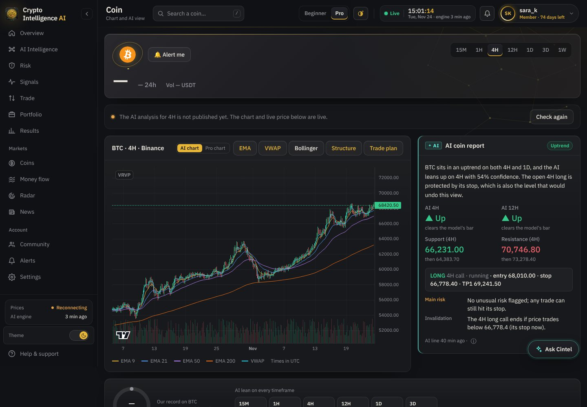

**Want to know more? Pro users.** Turn chart tools on and off above the chart: moving averages (EMA), VWAP, Bollinger bands, the structure levels and the trade plan. The coin's own record shows how its past signals did.

## Alerts and notifications {#alerts data-kicker="07" data-line="Let the app tell you when something happens"}

The app can notify you when a setup meets your conditions, so you don't have to watch the market constantly.

<ol class="steps" markdown>
<li markdown>Open **Alerts**.</li>
<li markdown>Start from a quick choice, or build your own: **My signals** (new signal, entry, targets, stop), **Market mood change** or **Big money moves**.</li>
<li markdown>Choose the **coin** (or all coins) and the **timeframe**.</li>
<li markdown>For signal alerts, choose the **direction** and tick **Strong signals only (grade A)** if you want fewer, stronger alerts.</li>
<li markdown>Press **Create alert**.</li>
<li markdown>Make sure phone notifications are on: **Settings → Notifications → Turn on notifications**.</li>
<li markdown>See everything that fired under **Fired alerts** on the Alerts page.</li>
</ol>

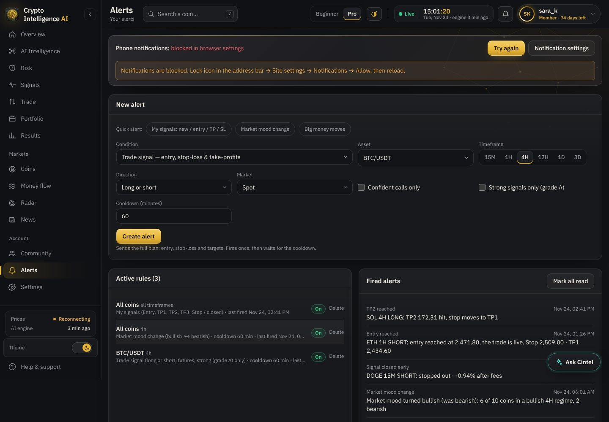
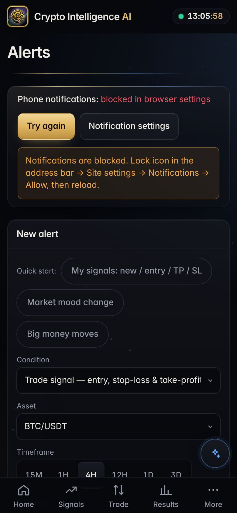

**Tip.** New members already get a **My signals** alert for every coin. Notifications usually arrive within a few minutes; they are not instant and can be delayed by your phone or network.

## Radar, news and the calendar {#radar-news data-kicker="08" data-line="Discover coins and understand what moves the market"}

### Radar
**What:** coins that are outperforming Bitcoin or suddenly getting more trading, shown on a radar screen and as cards.
**When to use it:** when you look for new coins to watch.

### News
**What:** the latest crypto headlines from several sources, with a market-mood line.
**When to use it:** when a coin moves sharply and you want to know why.

### Economic calendar
**What:** upcoming US economic releases, such as inflation and jobs reports, marked by importance.
**When to use it:** before trading. Big releases can move the whole market in minutes.

### Built-in news pause
**What:** no new signals from 45 minutes before to 30 minutes after a high-impact release.
**Why it helps:** it avoids starting trades just before a sudden spike.

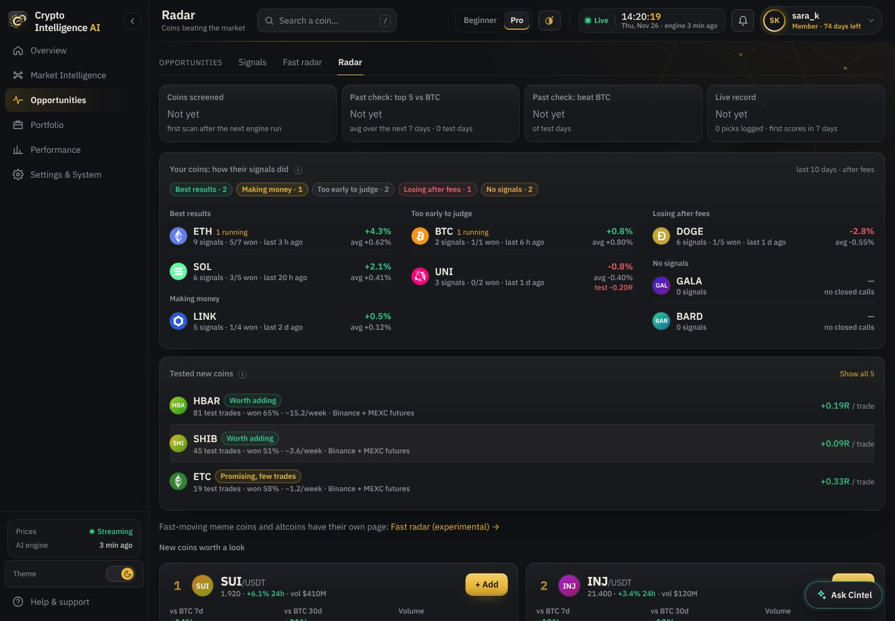
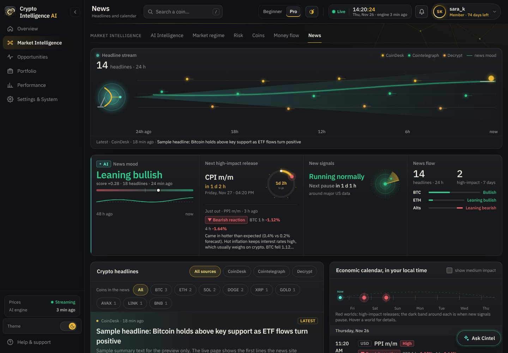

## Practise with virtual money {#practice data-kicker="09" data-line="Try every idea without risking a cent"}

The **Trade** page is your practice account. It uses **virtual USDT** on **live prices**. No order ever reaches an exchange.

### Your balance
New accounts start with **1,000 virtual USDT**. Need more? Press **Add funds** in Assets.

### Spot or futures
**Spot:** buy and sell coins. **Futures:** go long or short with leverage.

### Your record
Every position, order and closed trade is kept, so you can see how you are doing.

### Open a practice trade

<ol class="steps" markdown>
<li markdown>Open **Trade** and choose **Spot** or **Futures**.</li>
<li markdown>Pick the coin from the pair menu at the top of the chart.</li>
<li markdown>Choose **Market** (now) or **Limit** (at your price), and the amount.</li>
<li markdown>On futures, choose the **leverage**. Higher leverage means bigger gains *and* bigger losses, and a closer liquidation price.</li>
<li markdown>Add a **stop-loss** and **take-profit** if you like.</li>
<li markdown>Press **Buy / Long** or **Sell / Short**.</li>
<li markdown>Follow it under **Positions**. Close it any time with **Close**; past trades are in **Order history**.</li>
</ol>

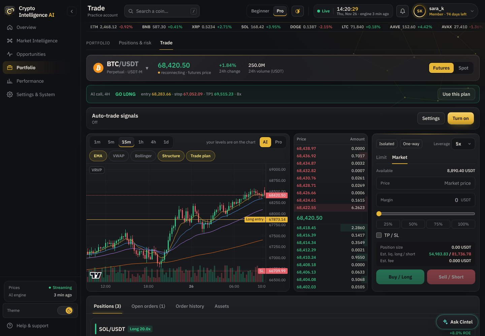
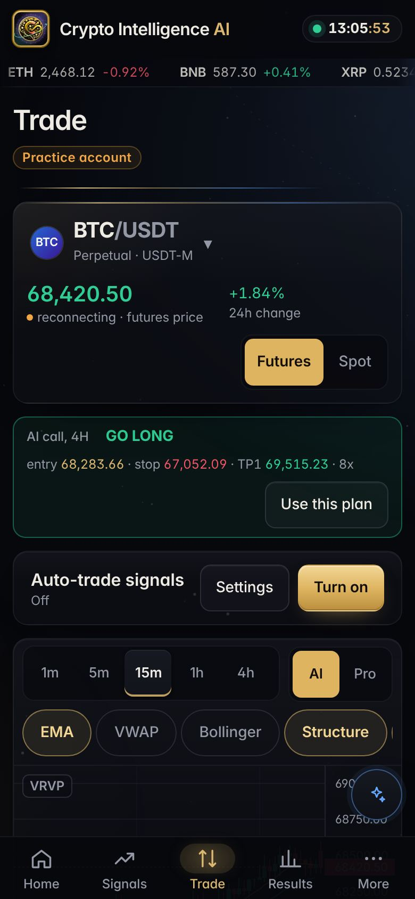

**Practice is a simulation.** Fills, fees and funding are modelled on real exchanges, but real trading can differ: prices can jump past your stop, and orders may fill at other prices.

## Auto-trade, practice only {#auto-trade data-kicker="10" data-line="Let the app place its signals in your practice account"}

Auto-trade copies the app's signals into your **practice futures account**, even while the app is closed. It uses **virtual money only** and **never places real orders**.

<ol class="steps" markdown>
<li markdown>**Find it:** open **Trade → Futures**. The **Auto-trade signals** panel is under the chart.</li>
<li markdown>**Open the settings:** press **Settings** on the panel.</li>
<li markdown>**Choose signal grades:** **Grade A only** (fewer, stronger) or **Grade A and B** (more trades).</li>
<li markdown>**Choose timeframes:** tap the ones you want, for example 1H and 4H.</li>
<li markdown>**Set the size:** the margin per trade in virtual USDT, the leverage (the signal's suggestion is the safest), where to take profit, and how many trades may be open at once (the app shows the limits).</li>
<li markdown>**Save** and press **Turn on**.</li>
<li markdown>**Review:** open **Auto-trade activity** on the panel to see every trade it placed or skipped, and why.</li>
<li markdown>**Turn it off** any time with **Turn off**. Open trades stay until they reach their stop or target.</li>
</ol>

**Tip.** Start with grade A and one or two timeframes. Watch the results for a few weeks before adding more.

## Demo bots: the AI in action {#bots data-kicker="11" data-line="Watch the signals trade on their own"}

**Demo bots** trade the app's published signals automatically with virtual money, one bot per timeframe. Open **Results → Demo bots**.

- **Compare timeframes:** each bot shows its return, its open positions and its closed trades.
- **Read a position:** entry, current profit or loss, leverage, liquidation price and which targets were hit.
- **Judge fairly:** look at many closed trades, not one or two. A few weeks and dozens of trades say much more than one good day.

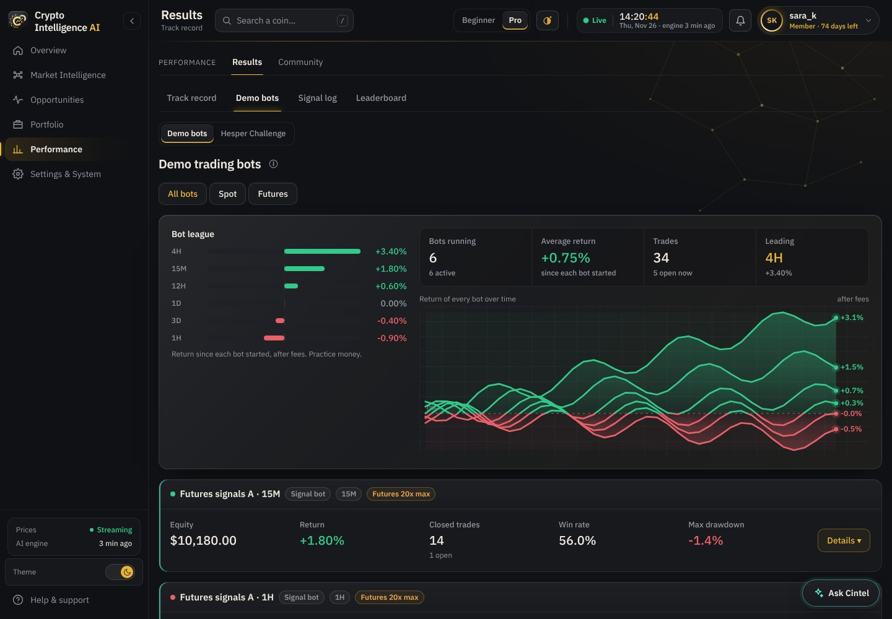

Demo bots show what *would* have happened with virtual money. Simulated and past results do not guarantee future results.

## Track the results {#results data-kicker="12" data-line="Judge the app by its real record"}

**Results** keeps every published signal, wins and losses, **after fees**. Nothing is hidden or removed.

### Track record
Win rate, total result, open and closed signals, and how they ended (targets, stops, time limit). Choose a period: since the start, today, this week, the last 7 or 30 days.

### Signal log
Every signal ever published, with filters by coin, timeframe, side and result. **Model accuracy** sits next to it and shows how often the AI's direction was right.

### Demo bots
How the signals did when traded automatically (section 11).

### Leaderboard
The best practice traders of the month (members with a username and at least 5 closed trades).

**How to judge the app.** Look at results **after fees**, over **many closed signals**, and compare winning and losing calls. The AI is not always right; a fair record shows both.

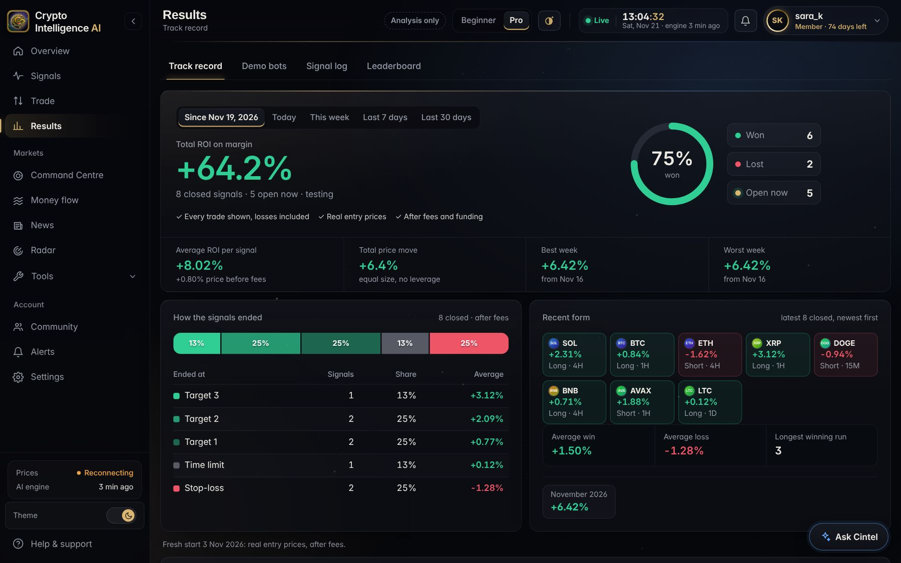

## Tools for smarter decisions {#tools data-kicker="13" data-line="Scanner, Backtest and Replay"}

Find them under **Tools** in the menu (on phones: **More → Tools**).

### Scanner
**What:** every coin in one table, with trend, AI signal and grade.
**When:** to compare coins quickly.
**Benefit:** the strongest ideas rise to the top.

### Backtest
**What:** runs a simple strategy on past prices, with fees.
**When:** before trusting a rule or a timeframe.
**Benefit:** you see wins, losses and the worst dip.

### Replay
**What:** shows what the AI said at an earlier moment, and what happened next.
**When:** to learn how signals play out.
**Benefit:** practice reading charts without hindsight.

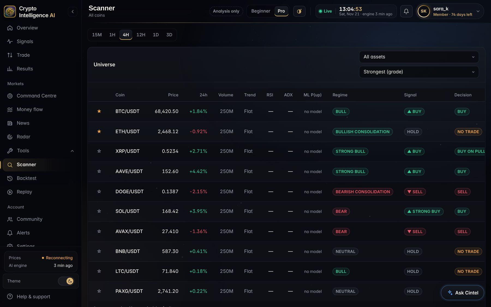

## Community and settings {#settings data-kicker="14" data-line="Talk with members and make the app yours"}

- **Community:** share ideas and questions with other members. Posting needs a username (choose one once; it can't be changed). Keep it friendly; nothing there is financial advice.
- **Appearance:** **Settings → Appearance**: themes, light or dark, glass effect.
- **Beginner or Pro view:** **Settings → View mode**, the switch at the top of the screen, or **More** on phones.
- **Notifications:** **Settings → Notifications**: turn on, turn off, send a test.
- **Membership:** **Settings → Membership** shows your plan and end date; renew there.
- **Invite friends:** **Settings → Invite friends**: share your link; when a friend pays for the first time, you get a free month.
- **Ask Cintel:** the **Ask Cintel** button answers questions about the page you are on, using the figures on that page. It does not give financial advice.
- **Support:** **Settings → Help & support → Contact support**, or email **support@cryptointelai.com**.

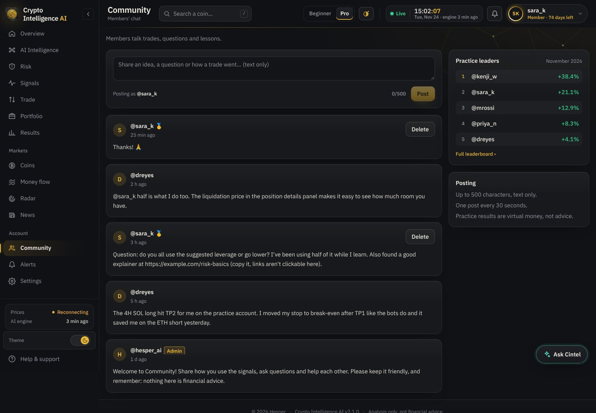
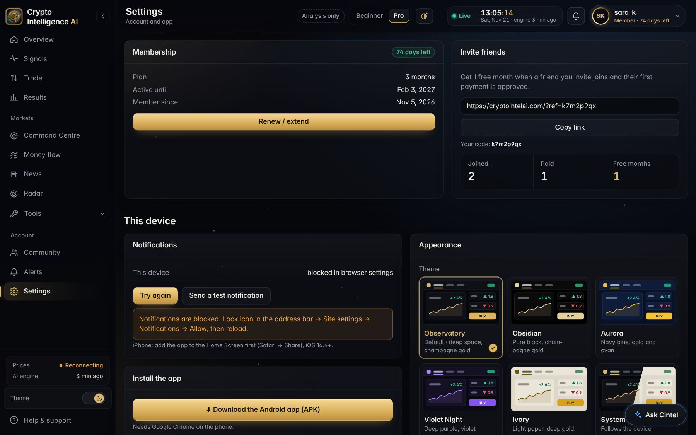

## Your daily routine {#routine data-kicker="15" data-line="A simple rhythm: a few minutes, a few times a day"}

You don't need to watch the app all day. Let alerts do the watching.

### Morning
- Check the market mood on **Home**.
- Look at new signals on **Signals**.
- Glance at your **alerts**.

### When an alert arrives
- Open the coin.
- Read the signal, the reason and the levels.
- Decide whether to practise it.

### Evening
- Check your practice positions on **Trade**.
- See the latest results.

### Once a week
- Review the **track record**.
- Compare the **demo bots**.
- Look at **model accuracy**.

## Quick help {#help data-kicker="16" data-line="Short answers to common questions"}

**I can't sign in.**
Use the same method as the first time (Google or email). With email, confirm your address first, or press **Forgot password?**.

**My membership is not active yet.**
Approval is done by hand after your payment screenshot arrives. Check that you sent the exact amount shown in the app. Still waiting after a few hours? Contact support.

**I see no signals.**
Most of the time the market has no good setup; that is normal. Try **All** timeframes and the **Active** filter on Signals.

**Why does it say WAIT?**
The AI found no setup it trusts right now, or a safety check stopped it (for example a news release). The card says which.

**Notifications don't arrive.**
Turn them on in **Settings → Notifications** and send a test. Android needs Google Chrome; iPhone needs the app added to the Home Screen from Safari.

**The app doesn't load.**
Refresh the page or reopen the app. On Android, update the app from **Settings → Install the app**.

**My practice trade won't open.**
Check your virtual balance (use **Add funds**), the amount and the leverage.

**Auto-trade didn't take a signal.**
Open **Auto-trade activity**: each skipped signal shows the reason (for example the open-trade limit or a timeframe you didn't choose).

**I have questions about the results.**
Every signal is listed in **Results → Signal log**, with its result after fees.

**How do I contact support?**
**Settings → Help & support → Contact support**, or email **support@cryptointelai.com**.

Crypto Intelligence AI provides analysis and practice tools, not financial advice. Trading involves risk, leverage can increase losses, and past performance does not guarantee future results.

